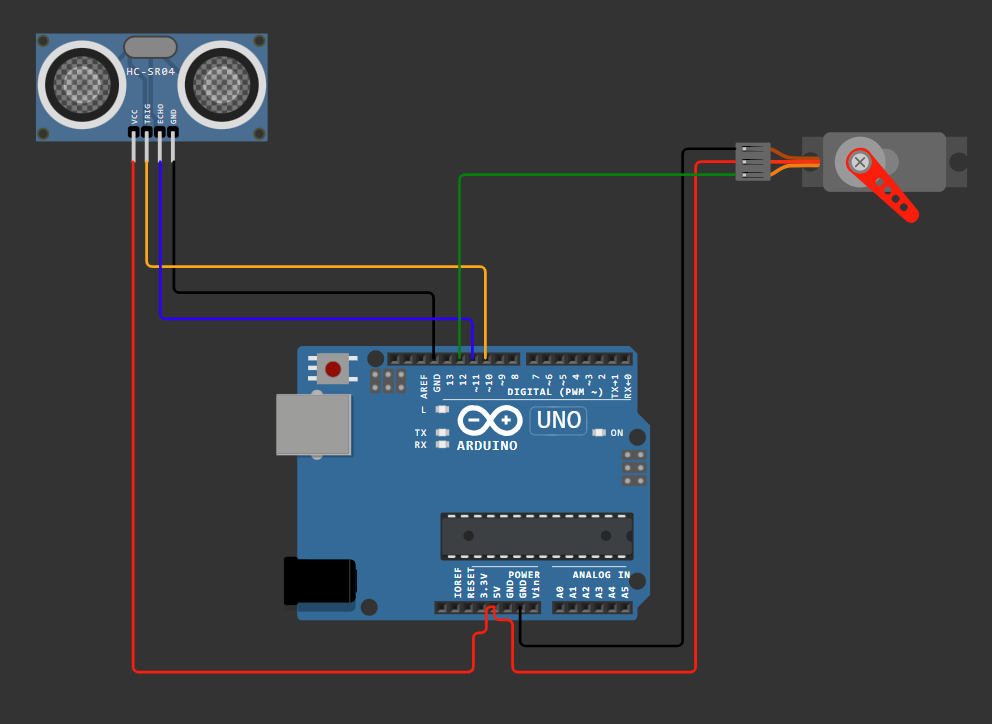

# 🛰️ Arduino & Processing Ultrasonik Radar Sistemi

Bu proje, Arduino Uno, HC-SR04 ultrasonik sensör ve SG90 servo motor kullanarak 15°–165° açılarında çevresini tarayan ve tespit edilen nesneleri Processing arayüzünde askeri radar simülasyonu olarak görselleştiren bir sistemdir.

---

## 📸 Devre Şeması & Simülasyon

---

## 🔌 Pin Bağlantıları

| Bileşen | Pin Adı | Arduino Pini | Not |
| :--- | :--- | :--- | :--- |
| **HC-SR04** | VCC | 5V | Güç hattı |
| **HC-SR04** | GND | GND | Ortak toprak |
| **HC-SR04** | Trig | Pin 10 | Tetikleme pini |
| **HC-SR04** | Echo | Pin 11 | Dinleme pini |
| **SG90 Servo** | VCC (Kırmızı) | 5V | Harici güç/Arduino 5V |
| **SG90 Servo** | GND (Kahverengi) | GND | Ortak toprak |
| **SG90 Servo** | Signal (Turuncu) | Pin 12 | PWM kontrol pini |

---

## 🚀 Kurulum ve Çalıştırma

1. **Arduino:**
   - `arduino/arduino_radar/arduino_radar.ino` dosyasını Arduino IDE ile açın.
   - Kart ve COM port seçimini yapıp karta yükleyin.

2. **Processing:**
   - `processing/processing_radar/processing_radar.pde` dosyasını Processing IDE ile açın.
   - Kod içerisindeki `myPort = new Serial(this, "COM3", 9600);` satırındaki portu kendi Arduino COM portunuzla güncelleyin.
   - Çalıştır (Run) butonuna basarak radar ekranını başlatın.

---
